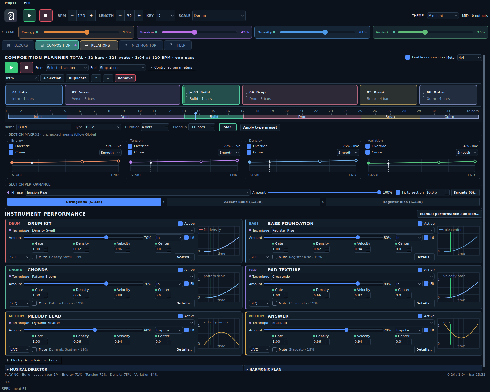

# Auricle v2.0 — consolidated changelog

## v2.0 · 2026-10-30 · Lightweight UI and callback lifetime

- UI-профиль algo_conf теперь применяется к сохранённым целям по их путям,
  без непрерывного отражения всего дерева Qt и массового создания borrowed
  QLayoutItem. Обычные Style/Font/Show события не запускают повторный обход.
- Runtime вынесен в `ui_profile_runtime.py`. Сохранены пользовательские значения
  профиля. Штатный запуск использует безопасный runtime и после экспорта старой
  версией algo_conf. Смена темы применяет профиль один раз и сохраняет splitter.
- Один UI heartbeat обновляет видимую вкладку; остановленный интерфейс опрашивается
  реже. Обновление пропускается, если MIDI-поток занят, вместо ожидания блокировки.
  Captions источников влияния зарегистрированы через weak references.
- Закреплённый Drum Kit сохраняется при выборе voice. Неизменённые карточки
  Perform/Composition переиспользуются; одинаковое выделение не меняет QSS повторно.
- Отложенные callbacks привязаны к QObject-контексту и отменяются с владельцем;
  удалённый piano roll не используется. Runtime снимает наблюдение при удалении окна.
- Планировщик объединяет только устаревшие polling ticks; остальные callbacks
  сохраняются. Это предотвращает длинные серии захватов общей блокировки после
  задержки. Убраны лишние вычисления ролей и копирование неизменяемых чисел
  при сборке Drum/Relations; группы графа без влияния не обходятся по всем шагам.
- Добавлены поведенческие проверки стоимости обновлений, удаления окна и
  планировщика; обновлены устаревшие source-assertions на QObject-контекст timers.
  Версия остаётся v2.0. Подробности: `docs/UI_PERFORMANCE_FIX_RU.md`.

## v2.0 · 2026-10-29 · Musical Drum Kit

- Добавлен Rhythm map: четыре авторских согласованных drum-рисунка с
  интерполяцией Map X/Y. Карта работает на всех размерах Kit в SEQ и LIVE,
  сохраняет роли, Half-time, опорные удары и разделение open/closed hat.
- Density в Rhythm map сначала убирает украшения, затем опорные удары;
  ноль остаётся полным выключением звука. Старый Role grid сохраняет прежнюю логику.
- Добавлены Motifs, Development и Return: ограниченный автомат Theme /
  Variation / Answer / Fill / Return с воспроизводимым развитием и перемоткой.
  Composition учитывает конец текущей секции для каденции; основной Play
  сохраняет независимое прослушивание Blocks.
- Добавлены редактируемые прямо в Drum Voice links: Support, Answer,
  Fill gaps, AND, XOR и Copy, сила, задержка, включение и удаление каждой связи.
  Источники и назначения отмечены цветами voices. Все связи читают один снимок
  плана, поэтому циклы не зависят от порядка обхода. Опоры и владение hat/fill
  остаются защищены.
- Кнопка Musical kit включает все три направления для существующего Drum;
  новые Drum-блоки получают этот режим сразу. MIDI-настройки и генераторы voices
  сохраняются. Новые непрерывные параметры доступны обычным маршрутам модуляции.
- Сохранена пользовательская раскладка algo_conf; исправлен обнаруженный сбой
  обхода объектов Qt при применении встроенного UI-профиля.
- Добавлены руководство `docs/DRUM_MUSICAL_RU.md`, демонстрационный проект и
  поведенческие, MIDI и Qt-проверки. Версия приложения остаётся v2.0.

## v2.0 · 2026-10-28 · Composition + Perform

- Вместо отдельных Perform и Composition — одна вкладка COMPOSITION.
- Цветные секции с настраиваемым цветом, пропорциональной полосой формы и timeline.
- Фраза, Amount, Targets и длительность/Fit сохраняются отдельно в каждой секции.
- Компактные карточки инструментов: Technique, Amount, Shape, Fit, Active, Gate,
  Density, Velocity, Register Center; графики 140×100 px с указателем проигрывания.
- Явная техника заменяет наследуемую, None отключает только технику. Targets
  ограничивает также музыкальное влияние Director, включая Drum Voices по родителю.
- Переходы, перемотка, цикл и Hold last корректно входят в нужную стадию фразы;
  нейтральные секции снимают временные слои и обновляют SEQ. Конечные значения
  удерживаемого приёма не вызывают постоянную регенерацию.
- Основной Play остаётся прослушиванием Blocks. Ручные средства исполнения
  доступны через Manual performance audition. Director и Harmonic Plan свёрнуты внизу.
- Новый пример `examples/unified_composition_demo.json`, актуальный скриншот,
  руководство `docs/UNIFIED_COMPOSITION_RU.md`. Версия остаётся v2.0.

## 2026-10-28 — Separate Blocks, Composition and Perform playback

- Make header Play a plain Blocks audition: bypass the saved Composition plan, section macros/expression and form endings; reset stale Perform phrases, techniques and release layers. Keep the saved Enable composition flag intact.
- Give Composition Play its own checked state and Stop scope. Switch playback modes through one MIDI scheduler, releasing old notes and regenerating under the new controls. Header Stop / Space remain global stop controls.
- Preserve a separate Composition cursor while auditioning Blocks. Form timeline edits during Blocks prepare a future start without seeking or cutting the sound check. Show an explicit BYPASS state and suppress ineffective Composition parameter feedback.
- Start Perform only from explicit phrase/technique controls, initialize the transport before arming the gesture, and stop phrase state with the transport. Restore saved card choices without silently restarting techniques on UI rebuild.
- Preserve playback mode, the Composition gate and form cursor through parameter/structural Undo/Redo; clear the old cursor when loading another project.
- Add captured-MIDI and native Qt regressions for mode switches, source attribution, note release, cursor isolation and explicit Perform startup. Version remains v2.0.

## 2026-10-27 — Key-safe Register Center automation

- Replace per-section chromatic Transpose with Register Center offset (−24…+24, relative to the block Center). Apply register placement before final scale/harmonic anchoring, while keeping Composition offsets out of source-pattern caches.
- Change Perform Register Rise/Fall and their phrase stages to relative Center gestures anchored to manual values. Retain the base for the whole gesture, restore it on stop/release, and use Center for Musical Director register motion too.
- Combine resolved parameter layers, Director motion and section offsets into a bounded effective Center. Preserve pitch classes through octave selection, including narrow registers and MIDI edges; keep complete chord tone sets and fixed Drum Voice notes.
- Pass the effective Center into Harmonic Plan anchoring and voicing. Use direct octave placement when a whole chord fits, retaining the full voicing resolver for impossible/narrow windows.
- Move Perform/Composition source dots and live register feedback to ROLE → Center. Exclude register placement from Transpose feedback; retain the separate manual Transpose control and explicit Relations stream feedback.
- Update the Composition column, parameter reference, Russian instructions and examples. Version remains v2.0.

## 2026-10-27 — Composition transport and form endings

- Add independent Play/Stop controls inside Composition, using the shared transport and the same theme-aware icons as the header. Composition Play enables the plan and starts/restarts from the selected section, form start or timeline cursor.
- Make the full-form timeline seekable. Drag previews the destination and seeks once on release, snapped to a sixteenth note; card selection remains independent from playback.
- Re-anchor SEQ, Euclidean, motif and Drum Kit schedules at the destination, release old notes and clear stale live/relationship histories. Preserve active Perform gestures on seek; free LIVE restarts at the destination without simulating skipped events.
- Replace the Loop checkbox with explicit End choices: Loop form, Stop at end and Hold last section. Save the choice with Undo/Redo support; preserve the prior hold behavior for non-looping projects.
- Stop at the exact musical form length, including fractional meters and tempo edits. Bound note tails and suppress later events; synchronize the main header and Composition UI after automatic completion.
- Add an expandable Controlled parameters reference in the tab and update the demo/manual. Version remains v2.0.

## 2026-10-27 — Composition curves and extended expression

- Fix premature MIDI note releases when editing Active in a future/other section or while Composition is disabled. Only a playing, active section may immediately release its notes.
- Add editable point curves for all four section macros, with Smooth / Linear / Step segments, normalized section time and live playheads. Add, drag and remove points with mouse/keyboard; retain one Undo step per drag.
- Add Blend in in musical bars, including transitions to Follow Global and the loop seam. The first start uses its own first point; non-looping playback holds the last endpoint. Keep existing projects' unconfigured transitions immediate.
- Feed automation into real SEQ/LIVE density, dynamics, variation and harmonic tension at event time. Keep source patterns and manual values intact; update source indicators, Global readouts and effective knob feedback from the same curve state.
- Add a selected-block/Drum Voice Expression strip: Gate, metric Accent, role-bounded Octave spread and Harmony anchoring. Retain drum note assignments and complete chord intervals.
- Add Perform techniques Dynamic Scatter, Register Bloom, Harmonic Resolve and coordinated Kit Evolution; consume velocity randomness in free LIVE generation and adapt Kit scatter to shared Humanize.
- Include a curve demo and updated Russian instructions. Version remains v2.0.

## 2026-10-27 — Real-time parameter feedback

- Preserve a hollow green Composition indicator in neutral sections and Follow Global states. Starting playback at the first section no longer looks like Composition has been disabled.
- Explain the start workflow beside Enable composition: enable once, then use main Play; selecting a section edits it without seeking the transport.
- Animate bound Inspector/Drum Kit knobs and value readouts from effective Perform layers and output-equivalent Composition/Relations influence. Keep a small outer tick at the manual setting.
- Show effective section macros in the Global header while retaining their manual project values; restore manual display when Composition is disabled.
- Refresh on the existing GUI heartbeat without emitting editing signals, regenerating notes, rebuilding the Inspector or creating Undo entries. Suspend display updates on controls being dragged.
- Keep missing authored expression parameters independent from transient layer values when resolving manual defaults. Version remains v2.0.

## 2026-10-26 — Source-coloured navigation

- Match Perform, Composition and Relations tabs to the violet, green and amber source indicators, with contrasting labels and their own icons in every theme.

## 2026-10-25 — Parameter source indicators

- Add compact eight-pixel colour dots to Inspector parameter captions, pinned Drum Kit controls and the Global macro header, without letters or extra control rows.
- Use violet for Perform, mint for Composition and amber for Relations; combine sources on one caption and explain them in hover tooltips and accessibility descriptions.
- Follow real Technique layers and their control policies, Director phrases, harmonic plans, the section at the transport position, stream Relations, built-in role connections, Dialogue and individual Drum Voice endpoints.
- Distinguish parameter layers from processing applied to output notes. Tooltips do not present stream effects as rewritten generator values; bypassed assigned layers have hollow dots.
- Refresh attribution on the existing GUI heartbeat with a nonblocking transport lock. Source observation does not regenerate notes, move knobs, rebuild the Inspector, write project data or create Undo entries.
- Include the new modules in Python packaging. Version remains v2.0.

## 2026-10-25 — Composition Planner UI

- Fix selected-section text contrast in all light and dark themes; draw clear card borders and distinguish editing selection from the active section.
- Add drag-and-drop section ordering, preserving stable IDs, per-block settings, persistence and Undo/Redo.
- Replace the progress bar with a full-form timeline: proportional sections, bar ruler, boundaries, transport playhead and loop-relative position.
- Place Name, Type and Duration captions directly above their fields.
- Show the total form length in bars, quarter-note beats and time at the current BPM; update it after duration, meter and tempo changes.
- Keep the timeline and status visible while the editor scrolls in compact windows. Version remains v2.0.
- Update existing layout/logo test fixtures for the Composition tab order and theme-aware transport icons.

## 2026-10-24 — v2.0

- Promote the current project to the v2.0 release line: `APP_VERSION = "v2.0"`, Python package version `2.0.0`.
- Add first-class Relations endpoints for individual Drum Voices. Source and Destination now expose entries such as `KIT / KICK`, with Voice→Voice, Voice→Block and Block→Voice routes in SEQ and LIVE.
- Extend the relation graph, delay/history handling, cycle diagnostics and transport dependency ordering to include Drum Voice owners while preserving the parent Drum bus.
- Persist, duplicate, validate and remove Drum Voice routes safely; retain the old block-level relation schema for existing projects.
- Keep the Relations UI compatible with numeric block IDs while adding colour-coded Drum Voice entries and clear endpoint labels.
- Add regression coverage for SEQ, LIVE, persistence and ownership validation. Full suite: 1511 tests passed.
- Remove temporary build/test caches and obsolete patch-release files from the clean distribution archive.

## v2.0 — Composition Planner (in development)

- Add a dedicated COMPOSITION tab with eight editable section types: Intro,
  Verse, Build, Drop, Break, Bridge, Transition and Outro.
- Add arbitrary section insertion, duplication, deletion, reordering and per-
  section bar lengths under a selectable global meter.
- Add optional section overrides for Energy, Tension, Density and Variation,
  plus per-block/Drum Voice Active, Density, Velocity, Transpose and Variation.
- Apply section performance controls at event time in both SEQ and LIVE so a
  later section can restore source-pattern events instead of losing them in a
  cached buffer. Keep the global macro baseline when section overrides are off.
- Persist the arrangement in project JSON and include it in document history;
  keep Composition disabled by default so existing v2.0 projects retain their
  previous playback until the user enables the planner.

## Release highlights

- Algorithmic MIDI generation for DRUM, BASS, MELODY, PAD and CHORD blocks.
- Drum Voices / Kit with shared timing, roles, MIDI note/channel routing and individual sound settings.
- SEQ/LIVE generation, motifs, Perform techniques, global macros, harmonic plans and Instrument Dialogue.
- Typed Mutators, Process chains, stable Relations graph, Undo/Redo, MIDI Monitor and project persistence.

## Historical changes

## v111 — GitHub and build preparation

- Include the complete current asset set in source, wheel and native builds.
- Preserve the supplied logo colours across themes; use native ICO / ICNS icons.
- Include all current runtime modules in the Python package and resolve artwork independently of the working directory.
- Add the macOS bundle, versioned native archives, CI, startup smoke checks, release notes and SHA-256 sums.
- Add a current project overview, build/publishing guides and the supplied screenshot.
- Remove obsolete patch installation requirements from the current README; keep historical guides for reference.

## v111 — Instrument dialogue (2026-10-19)

- Add Dialogue as an inline Relations operation with call/response bar lengths,
  meter, pauses, separation, cycle probability and Own phrase/Echo/Contrast.
- Capture accepted call events after mute/probability gates; shape the reply's
  contour and accents without copying the caller's absolute register or old
  harmony. Keep the destination's rhythm, CHORD/PAD voicings and Drum MIDI notes.
- Use one dispatch path for SEQ, LIVE, motifs and Drum Voices, with bounded
  per-cycle memory and releases at turn boundaries. Keep generator phase.
- Display a colored timeline and current turn in Relations and Perform; retain
  parameter editing by wheel/buttons, project persistence and document history.
- Bypass missing/self/conflicting Dialogue pairs with a visible explanation;
  preserve ordinary Relations and built-in role routes.
- Add behavioral/MIDI/Qt checks, a six-block demo and a Russian guide.

## v111 — Harmonic plan register fix (2026-10-18)

- Keep CHORD/PAD voicings inside the block's Base Note + Role Center/Width
  register before optimizing movement to the previous chord. Repeated plans
  no longer climb or descend through octaves toward the MIDI limits.
- Apply register edits on the next event, including within a held chord.
  Preserve complete voicings, inversions and chord tones; wide voicings use
  the closest fitting octave instead of clipping individual notes.
- Add long-loop regression tests, captured SEQ/LIVE MIDI, register edits and
  MIDI-boundary checks. See docs/CHORD_REGISTER_FIX_RU.md for installation.

## v111 — History, parameter influences and harmonic plan (2026-10-18)

- Add bounded document Undo/Redo, gesture grouping and saved-state tracking;
  restore graph edits and Drum Voices without recording automated parameter
  motion or note buffers. Keep transport position while ending active gestures.
- Add atomic per-session crash recovery without overwriting the saved project.
- Track actual macro, technique and Parameter Modulation writes; expose a live
  read-only influence card from parameter values and the Edit menu.
- Add a compact Perform harmonic plan and an inline chord editor with presets,
  meter, bar durations and loop/hold. Resolve CHORD/PAD voicings, bass roots and
  melody anchors after stream processing in both SEQ and LIVE; expose context.
- Keep explicit chord pitch classes and restrict long notes to chord boundaries.
- Preserve phrase targets as settings. Guard queued card edits across restores.
- Fix overlapping transport controls at narrow widths and avoid globally
  reapplying an unchanged Qt theme when another window is created.
- Add behavior/MIDI/Qt tests, an all-role demo and a Russian installation guide.

## v111 — Kit workflow: output, chances and sound copying (2026-10-18)

- Add a Plan/Output view with bounded per-voice accepted-event history, velocity
  bars and distinct rests/unvisited slots. SEQ generation monitoring also works
  without an attached MIDI output. Replay clears history; STOP retains it.
- Add persistent per-step Pattern chances as deterministic per-pass output
  gates in SEQ/LIVE. Provide a compact Step/Chance editor and All 100% reset.
- Add detached Copy/Paste sound settings for Drum Voices, preserving identity,
  role, mode, mute and MIDI routing; add one-paste undo per voice. Keep transport
  phase, clear old generator memory and stop the target's active technique.
- Add MIDI/behavioral/Qt tests, a workflow demo and a Russian installation guide.

## v111 — Drum Kit meters, variation and processing (2026-10-18)

- Add seven meter presets, group-aware bar plans and a variable-length playhead.
- Add Complexity, Syncopation, Toms, Variation and a persistent New variant;
  toms can play throughout the bar even from a silent source pattern.
- Apply parent DRUM mutations/processes after each voice chain. Process whole
  LIVE windows so time-based transforms retain phase and history within a cycle.
- Keep beat is optional; retain explicit dynamics gates and hat/fill exclusion.
  Seed audible hits created by rhythm processes, preserve density/accent results
  between voice and kit stages, and make zero-duration timing mutations silent.
- Sample parent Parameter Modulation once per grid slot; retain fractional kit
  values and refresh SEQ children even when their parent is labelled LIVE.
- Add behavioral/Qt tests, a mixed-mode 7/8 demo and a Russian patch guide.

## v111 — Stage 3 groove / Kit Plan fix (2026-10-18)

- Infer missing voice roles from recognizable instrument names before GM notes;
  custom hardware note maps no longer collapse the whole kit into Perc. Keep
  explicit roles; add Auto roles repair and a missing-foundation hint.
- Preserve the snare backbeat with clap as an optional layer, begin fills on
  the existing backbeat and retain the role's timbre across each bar.
- Protect groove anchors from rhythm mutations/processes while retaining
  explicit density/probability controls, including a hard zero-density gate.
- Add a numbered 16-step ruler and a visible rest-independent playhead, with
  separate beat boundaries and optional-slot outlines. Verify all 16 positions
  on rendered Qt widgets and both modes on non-GM MIDI note maps.

## v111 — Stage 3: coordinated Drum Kit (2026-10-17)

- Added a deterministic shared kit planner with persistent voice roles,
  Straight / Half-time / Broken styles, 1–8 bars and one fill lead per tail slot.
- SEQ/LIVE voices share a sixteenth-note grid across mode switches, edits and
  tempo changes. Motif development continues; final masks preserve hat/fill
  exclusivity after rhythm processing. Free voices retain independent timing.
- Added hat Note Off ownership handling, channel-override coverage and correct
  LIVE source positioning for coordinated Drum → Bass / explicit relations.
- Added pinned coordination controls, role selectors, current-bar plan lanes
  and a transport playhead without rebuilding the panel during knob drags.
- Added behavioral/Qt tests, a mixed-mode kit demo and a Russian installation
  guide. Delivery includes only changed/new files relative to motif stage 2.

## v111 — Motifs stage 2: bounded development (2026-10-17)

- Added a separate motif_development module: repeatable melodic/rhythmic
  variants, limited edit budgets, protected metrical/phrase/accent anchors,
  configurable cycle periods and periodic returns to the immutable theme.
- SEQ regenerates when its scheduled source variant changes; LIVE reads the
  same variant. Pending settings commit at cycle boundaries. Early humanized
  notes cannot rewind a variant or prematurely advance sibling Drum Voices.
- Added compact Inspector controls for development, capture, holds, eight
  distinct recent variants, recall and saving a variant as a reusable theme.
  Captures and holds persist in projects; history is session-local.
- Added role/generator coverage, MIDI comparisons, boundary/early-onset,
  persistence and Qt interaction regressions, plus a demo and Russian guide.
- Delivery is a changed/new-files-only patch against motif stage 1.

## v111 — Motifs stage 1: shared beat clock (2026-10-17)

- Added a transport-owned quarter-note clock shared with phrase / technique
  progress. Tempo edits preserve fractional beat position; delayed ticks no
  longer discard elapsed musical time or restart the current phrase stage.
- Bound motifs now play their complete note/rest/velocity sequence in LIVE
  and SEQ, independently of generator rest masks and project pattern LENGTH.
  The first delayed worker tick retains the opening note. Mute, regeneration
  and SEQ/LIVE switching preserve motif phase; stalls skip overdue slots.
- Added per-block / Drum Voice motif selection and Step controls in SOURCE,
  a current-position readout, explicit Off and scoped Phrase auto modes.
  Inspector updates resolve current widgets and retain the pinned kit.
- Unified motif dynamics / articulation across SEQ and LIVE. Existing free
  LIVE generators keep their own timing and dynamics behavior.
- Added a demo and Russian usage guide. Motif evolution/history and coordinated
  kit arrangement are deliberately left for subsequent stages.
- Validation: 495 automated tests pass, including 19 new clock/MIDI,
  dynamics, persistence and Inspector cases. The kit lifecycle regression
  waits for the coalesced edit instead of assuming a fixed UI rebuild time.

## v111 — Drum Kit preview lifetime fix (2026-10-17)

- Fixed `AlgorithmPreviewWidget already deleted` when changing kit Density,
  Humanize or Fill with the parent DRUM selected. The hidden parent SOURCE
  section no longer creates a preview and stays owned by the Inspector page.
- Preview updates now resolve the current page's widget and verify its block
  and project, rather than retaining a Qt wrapper across Inspector rebuilds.
  The same fix covers ordinary parameter and mutation editor updates.
- Added regression tests that reproduce the original exception and cover
  parent/voice selection, page replacement and project switching during the
  pending 35 ms kit update.
- Validation: 476 automated tests pass, including 9 new lifecycle regressions.

## v111 — Working Drum Kit controls (2026-10-17)

- Connected kit Density, Swing, Humanize and Fill to SEQ and LIVE generation.
- Added deterministic hit retention, bounded timing/velocity humanization,
  paired LIVE swing, and fills in the final quarter of each structure cycle.
- Kit controls combine with voice settings without overwriting them. Fill
  candidates pass through the normal voice processing and master density gate.
- Neutral defaults are Density 1 and Swing/Humanize/Fill 0; explicit saved
  values remain active. Added tooltips describing each control.
- Coalesced kit edits under the transport lock; no editor rebuild or LIVE
  phase reset while dragging. Preserve LIVE snapshots during SEQ regeneration.
- Fixed SEQ voice regeneration inside a DRUM container whose mode is LIVE.
- Added generator, timing, relation-source, persistence and UI behavior tests.
- Validation: 467 automated tests pass, including 62 kit-control cases.

## v111 — Inline Mutators and Relations (2026-10-16)

- Unified Mutation, Process and Relations creation: `+ Add` immediately adds
  an editable row, without a separate dialog.
- Mutator type, target and amount can now all be changed in place.
- Replaced the relation table / selected inspector pair with a scrollable
  inspector containing every editable route. Each row has Enable, Copy and
  Remove controls; filtering is retained and new rows scroll into view.
- Added block-colour markers to both Source and Destination menus and their
  selected values. Markers and names refresh after block edits.
- Mutation and Process additions now belong to the selected Drum Voice when
  its settings are open. Process type changes also work on that voice.
- Saved mutation chains now restore exactly; removed default mutations are
  no longer reinserted on loading. Drum Voice mutation/process objects are
  properly reconstructed from JSON.
- Replaced outdated table-specific source checks with behavioral UI tests.

## v111 — Perform compact layout and phrase duration (2026-10-16)

- Removed the separate Phrase Form panel from Perform.
- Removed the Technique Curve caption; retained the 140 × 100 px parameter plots.
- Tightened card rows and placed Enable / Restart side by side.
- Added Global Phrase → Duration in quarter-note beats (4–256). Phrase stages
  and the Director contour stretch proportionally. Editing a running phrase
  preserves its progress, including the active technique's progress.
- Saved the selected phrase, duration and amount with the project.
- Made timeline ruler labels adapt to long phrases.
- Added runtime and UI persistence coverage; 412 tests pass.

## v111 - Perform UI bug fixes

- Added collapsible Global Phrase, Macros, Form and Musical Director sections.
- Timeline and Form now follow each phrase's real stages and beat total.
- Fixed stopped-transport phrase preview, live Amount updates and LIVE activity metering.
- Added phrase target selection, route hints, dynamic curve legends and theme-aware drawing.
- Reworked Perform cards to use content-driven height and accessible action labels.

## v110 - Perform UI

- Added a 16-beat phrase timeline with stage segments, progress fill and a
  moving playhead.
- Added normalized Technique Curve charts to each Perform block card; the
  chart shows which parameters the selected gesture moves over time.
- Standardized card height, grid expansion and control widths for readable
  two-column Perform layouts.
- Documented Shape semantics: `in`, `out`, `in/out` and `pulse`.

## v109 - LIVE velocity balance

- LIVE `velocity_base` techniques now blend toward their target instead of
  replacing natural event velocity, keeping Crescendo and Diminuendo musical
  at phrase boundaries.
- LIVE accent techniques use a bounded accent contribution and avoid clipping
  the whole event stream.

## v108 - LIVE technique adapter

- LIVE now consumes active Perform technique values for timing rate, swing,
  humanization, timing offset, gate, velocity base/accent and Euclidean phase.
- Temporary LIVE overrides stay in the active performance runtime and do not
  overwrite the saved block parameters.
- Added behavioral coverage for timing, articulation, dynamics and Euclidean
  phase changes in LIVE mode.

## v107 - Core module split

- Split the former monolithic `auricle_core.py` into `auricle_model.py`,
  `auricle_catalogs.py`, `auricle_engine.py`, `auricle_relations.py`,
  `auricle_persistence.py` and `auricle_transport.py`.
- Kept `auricle_core.py` as a small current-API facade for the GUI while
  removing legacy PERCUSSION project migration code.
- Removed tests that only protected obsolete project formats or source-file
  layout; behavior tests now target the responsible module.
- Replaced `assets/auricle_logo.png` with the supplied logo.

## v106 - Drum Machine voices

- Replaced the standalone PERCUSSION block type with a nested DRUM Machine.
- Added independent KICK, SNARE, CLOSED HAT, OPEN HAT, CLAP and PERC voices.
- Each voice owns its algorithm, SEQ/LIVE mode, MIDI channel, base note, mute
  state and output stream; the parent DRUM output remains the union used by
  Drum -> Bass relations.
- Added compact Drum Voice/KIT controls to the DRUM inspector, including a
  16-step SEQ lane, LIVE stream mode and per-voice routing. Selecting a voice
  opens the normal generator/structure/musical/motion/monitor controls for that
  sound, and voice names can be edited and saved.
- Pinned Drum Voices / Kit above the scrolling voice Inspector, so voice
  selection keeps the kit visible while parameters appear below.
- Switching a voice between SEQ and LIVE in Drum Voices / Kit refreshes its
  Pattern / LIVE stream lane and the selected voice's Inspector after the
  button event completes, preserving the Inspector's scroll position.
- Re-applied relations after live child voices update the parent Drum snapshot,
  keeping parent Drum sources and destinations audible in both modes.

## v105 - Live relation and MusicalContext wiring

Live transport blocks are ordered after their LIVE relation sources, including
built-in Drum -> Bass and Chord -> Melody links, so reordering blocks no longer
changes which event a destination hears. Bass rhythm and velocity shaping use
the selected Drum source consistently. MusicalContext now analyzes chord
activity, publishes harmony metrics and lets harmonic confidence adjust Chord
-> Melody anchoring alongside groove metrics.
Mouse-wheel editing remains active while the pointer is over a knob or numeric
stepper; keyboard focus is no longer required for hover-based adjustment.

## v104 - System stability

Threading and MIDI UI
- MIDI monitor, piano-roll history, activity LEDs and status messages are
  marshalled to the Qt thread through queued signals; the transport worker no
  longer touches widgets directly.
- Transport state and native MIDI port operations are serialized with a
  re-entrant lock during PLAY/STOP and port refresh.

Musical relations
- Director PerformanceState dataclasses now update MusicalContext energy and
  tension instead of being silently ignored.
- Bass groove shaping follows the selected Drum source, stale groove resets
  when no drums remain, and Drum/Chord regeneration rebuilds dependent SEQ
  blocks before applying relations.
- LIVE rests remain zero after role or user relations and chord anchoring no
  longer wraps forward to a future chord step.

Persistence and input
- Macro edits, macro routes, randomize and mutator changes mark the project
  dirty so destructive navigation cannot discard them silently.
- Knob and stepper wheel changes require keyboard focus.

Tests
- Added v104 regressions for Director context, groove source/reset/rebuild,
  LIVE rests, chord timing, Qt signal marshalling, dirty tracking and focus.

## v103.2 - Stability

Transport
- Lookahead tick scheduling is idempotent: duplicate planned timestamps are ignored.
- Worker callback exceptions are logged with traceback and counted instead of being swallowed.
- Added regression coverage for queue deduplication, BPM-grid dispatch and failure reporting.

Musical context
- Drum rhythm and accent streams are analyzed into density, syncopation, accent and groove metrics.
- MusicalContext.groove is refreshed before dependent SEQ/LIVE generators run, so Drum → Bass
  behavior responds to the actual selected drum pattern.
- LIVE generators publish a one-step rest before relation evaluation when a pattern/probability/
  density gate skips an event, preventing stale Drum or Chord events from leaking downstream.
- Added behavioral tests proving sparse and dense drum patterns produce different bass timing.

GUI safety
- Unsaved project changes are marked in the window title and prompt before New, Open or Quit.
- Saving clears the dirty marker; loading a project starts a clean editing session.

## v102.2 - Engine fixes

Tonality and harmony
- Final quantization compared relative pitches with the absolute root, shifting the scale by the
  key: non-C keys could send wrong notes (A major sent D#). Pitches are now quantized in the
  root-relative frame everywhere (SEQ, LIVE, relations, chord anchor).
- CHORD/PAD voicings stack diatonic thirds on the degree of the generated root (a fixed I-chord
  shape transposed onto every root produced chords such as A-C#-E in C major).
- Chord -> Melody anchoring is quantized to the melody scale again (it produced C#, Bb, Ab in C).
- quantize_interval_to_scale considers the next octave (11 -> 12 in a pentatonic, not 11 -> 9).
- Voice Smooth: 0 = free movement (it froze the voice on one note), 1 = nearest-octave voice
  leading with a tight leap limit; no fractional blending; SEQ smoothing is deterministic.

Timing
- Swing delays the off-beats (it made them early).
- Humanize jitters each step only; it no longer accumulates into a drift off the grid.
- Mute only releases notes: the clock and the pattern position keep running, so unmute is in phase.
- After a stall the missed steps advance the pattern too; blocks added or switched to SEQ during
  playback join the shared 16th grid.

Relations
- Relations aimed at LIVE blocks are audible: events are built after relations, and LIVE
  destinations read their sources at the current transport step instead of step 0.
- Pitch relation results stay in the destination scale; rhythm relations give new hits the
  block velocity and gate (they were sent with velocity 1).
- relation_drum_source / relation_chord_source select the built-in groove/harmony source again.
- Groove mode "Replace" keeps only the selected drum hits (it behaved like "Union").
- The groove stage runs for SEQ and LIVE alike.

Director, persistence, performance
- LIVE events no longer apply event probability twice while a phrase runs.
- Phrase stage crossfade uses the intended in/out curve (typo "in-out").
- Projects are saved atomically: a failed save keeps the previous file intact.
- LIVE blocks outside every relation skip the project-wide relation pass.

Tests
- 84 new regression tests (all 12 keys x 5 generators send in-scale MIDI, chords per scale,
  swing/humanize/mute/grid, LIVE relations, atomic save...). test_v114 now checks sent MIDI notes,
  and the curve/delay test checks a non-pitch dimension because pitch results are quantized.

## v102.1 - UI fixes

Themes and palette
- Every theme colour is derived from theme tokens: PLAY/STOP/DELETE/× no longer use
  hard-coded dark fills (on Solar/Cream Studio the text contrast was 1.2-1.6:1, now >= 7:1).
- Text on accent/success/danger surfaces is picked for WCAG contrast (SEQ/LIVE on Mono was 1.5:1).
- A QPalette is built from the theme and applied app-wide with the stylesheet (Fusion base style):
  knobs, piano roll, preview, dialogs and menus now follow the theme instead of default blue.
- Logo and tab icons are tinted with the theme colours (the white logo was invisible on light themes).
- Styled checkboxes (indicator was invisible on dark themes), scrollbars, menus, combo popups,
  disabled states and slider fill; labels no longer paint background patches inside cards.

Layout and widgets
- "SCALE & PITCH" title rendered as "SCALE _PITCH" (Qt mnemonic) - escaped.
- Stepper "+" button was clipped; steppers round "12.6" and ignore horizontal scrolling.
- Knobs: visible keyboard-focus ring, trackpad scrolling for integer knobs, double-click resets
  to the real default (STRUCTURE/TIMING/ROLE/MUTATION/HARMONY used the current value).
- Inspector fills the window after resize/maximize; empty Inspector page is installed when no block
  is selected; nested groups re-measure on expand (clipped knob values).
- Process controls: label above combo/checkbox, wider cells (combos were clipped); route
  parameters shown with readable names. Algorithm preview caption was drawn outside the widget.
- HARMONY is shown only for PAD/CHORD and ROLE only for roles that have a register profile.
- Block list has no horizontal scrollbar; Relations inspector captions/controls are aligned;
  built-in DRUM→BASS / CHORD→MELODY relations are explained on the Relations tab.

Perform tab
- FORM panel and phrase stage strip follow the running PhraseState (they were static placeholders).
- Card diagnostics show live groove/harmony sources, relation counts, motif and density.
- Phrase STOP stops the running phrase even after the selector moved; STOP is disabled when idle.
- A finished technique switches its card to OFF (it stayed ON and restarted on every card rebuild).
- Selected Perform card border is visible; mute/mode changes update cards in place; changing
  type/algorithm/mode in the Inspector refreshes the Perform cards; replaced cards are hidden at once.
- Director controls are re-applied to the engine after New/Open project.

Main window
- Project menu: New (Ctrl+N), Open (Ctrl+O), Save (Ctrl+S), Save as (Ctrl+Shift+S), Refresh MIDI (F5),
  Quit; Space toggles PLAY/STOP; window title shows the project file; save errors of any kind are reported.
- New blocks get their role defaults and the first free MIDI channel.
- MIDI activity LEDs restyle only on state changes (one timer per burst); the MIDI monitor is
  flushed in batches on the 80 ms UI heartbeat; button sync moved off the 5 ms MIDI clock.
- Accessible names for steppers, knobs, combos and relation fields.
- help_content.py runs on Python 3.9-3.11 again (no line breaks inside f-string fields).

## v102.0 - Tonality hardening release

- Full tonality validation across pitch generators.
- Fixed relative/absolute pitch separation.
- Added rhythm validation coverage.

## v101.2 - Real rhythm-first relations

- Added automatic Drum → Bass groove masks with stable per-step follow amount,
  groove offset, velocity accents and generated note durations.
- Added automatic Chord → Melody nearest chord-tone anchoring with configurable
  strength and reuse of the last active chord across chord rests.
- Exposed the relation controls in each BASS/MELODY role panel and added
  focused regression tests.

## v100 - Musical Director cleanup

- Unified phrase execution around a single `PhraseState`; removed the legacy parallel phrase-state dictionary.
- Connected PhraseState stage progression, smooth STOP/release snapshots, target blocks and active motifs.
- Added real TensionCurve presets (Gentle rise, Crescendo, Peak and release) and separated tension amount from curve smoothing.
- Loaded/saved Motif data into the runtime MotifEngine and applied active role motifs to SEQ and LIVE representations.
- Applied Director Energy, Density, Probability and Register influence to actual generation instead of writing temporary block parameters.
- Connected Perform Voice smooth to the real VoiceLeading smoothness and kept voice leading role/register safe.
- Added Director influence to LIVE generation and preserved scale-safe output while the Director is inactive.
- Added mid-phrase PhraseState/Motif persistence and v100 integration tests.

## v99
- Motif / PhraseState / TensionCurve foundations.
# Audit fixes (2026-10-15)

- Coalesced Global Macro route application so slider drags generate once per burst.
- Applied Energy, Density and Variation macros to LIVE events as well as SEQ material.
- Restored the visible phrase selector and amount from loaded PhraseState without marking projects dirty.
- Preserved Drum Voice MIDI channel overrides from the full Inspector and refreshed the pinned kit after voice edits.
- Cached MIDI output discovery for the drum kit and Inspector; inherited Drum Voice ports now reopen correctly.
- Aggregated Drum Voice MIDI history in the parent piano roll and recorded all pitches for CHORD/PAD history.
- Made header macro sliders adaptive to the window width and exposed built-in relation status in the Relations tab.
- Equivalent visible DRUM→BASS and CHORD→MELODY routes replace their built-in transforms instead of stacking.

