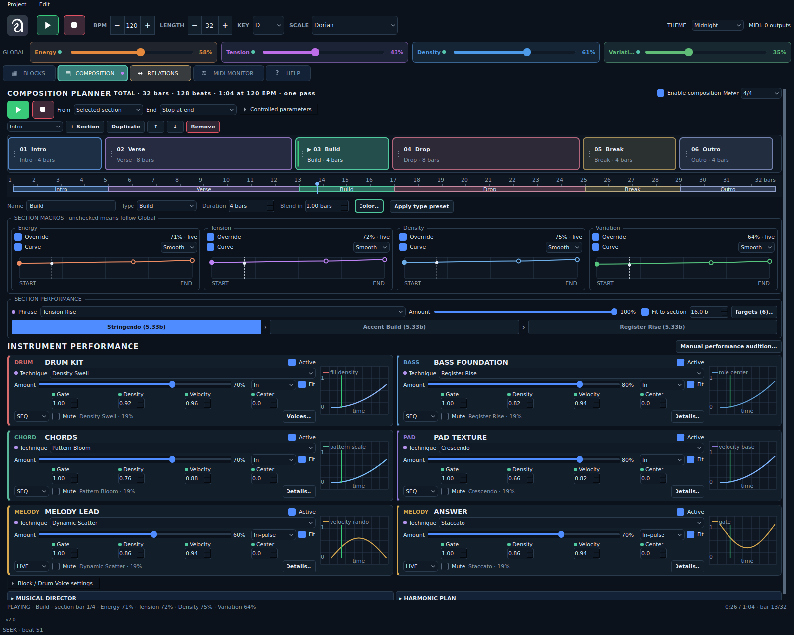

# Auricle · Algorithmic MIDI Generator

**Auricle v2.0** — настольный генератор MIDI-партий для драм-машин, синтезаторов и DAW. Собирайте композицию из независимых блоков, развивайте мотивы и задавайте музыкальные связи между инструментами.

*Auricle is a desktop algorithmic MIDI generator for hardware instruments and DAWs. Build evolving arrangements from independent drum, bass, melody, pad and chord blocks.*



Скриншот пользовательского интерфейса v2.0. Приложение генерирует MIDI-события; звук воспроизводит подключённый инструмент или DAW.

Основной Play запускает Blocks для настройки сэта без Composition и фраз/приёмов Perform. Форму с назначенными секциям фразами и приёмами запускает кнопка Play в Composition. Ручное прослушивание доступно через Manual performance audition. Подсветка кнопок независима; сохранённая галочка Enable composition остаётся на месте.

## Возможности

- **Пять типов блоков:** DRUM, BASS, MELODY, PAD и CHORD. Для каждого доступны генератор, параметры, MIDI-выход и режим SEQ / LIVE.
- **Drum Voices / Kit:** отдельные Kick, Snare, Hat, Tom и другие голоса, собственные ноты и каналы, общий канал кита с переопределением для голоса. Согласованный рисунок, размеры 2/4–12/8, вариации, синкопы, fills и Plan / Output.
- **Musical Drum Kit:** карта согласованных ритмов Map X/Y, развитие Theme / Variation / Answer / Fill / Return и редактируемые связи отдельных voices. Density убирает украшения раньше опорных ударов. Включение всех трёх направлений одной кнопкой Musical kit. [Руководство](docs/DRUM_MUSICAL_RU.md), демо `examples/musical_drum_demo.json`.
- **Алгоритмы и мотивы:** Euclidean, Random Walk, Markov и другие генераторы; захват мотива, вариации, история и возврат к исходной теме.
- **Composition + Perform:** одна вкладка с цветными секциями, кривыми макросов, фразами и инструментальными техниками для каждой секции. Компактные карточки с графиками и указателем времени; два столбца на широком экране и один на узком. [Новое руководство](docs/UNIFIED_COMPOSITION_RU.md). Energy, Tension, Density и Variation доступны в общей верхней панели.
- **Composition Planner:** форма из восьми типов секций, длительности в тактах, редактируемые кривые четырёх макросов и плавные переходы. Собственные Play/Stop, запуск с выбранной секции, перемотка и завершение Loop/Stop/Hold. Автоматический регистр управляется через Register Center с сохранением гаммы и аккордовых тонов; доступны Gate, Accent, Octave spread и Harmony. По умолчанию выключен. [Руководство](docs/COMPOSITION_PLANNER_RU.md).
- **Музыкальные связи:** Relations, Drum → Bass, Chord → Melody; гармонический план связывает аккорды, бас и мелодию в SEQ и LIVE.
- **Диалог инструментов:** чередование вопроса и ответа, паузы, длина реплик, Own phrase / Echo / Contrast и наглядный таймлайн.
- **Редактирование:** процессы и мутации в строках, Undo / Redo, восстановление прерванной сессии, отображение влияний на параметры и проекты JSON.
- **Источники влияния:** цветные индикаторы 8 px рядом с параметрами — Perform, Composition и Relations; подробности доступны при наведении. [Описание](docs/PARAMETER_SOURCES_RU.md).
- **Наблюдение и оформление:** MIDI Monitor, piano roll, цветные блоки, темы интерфейса и встроенная справка на русском и английском.

- **Адресная автоматизация:** Composition → AUTOMATION, значения и кривые параметров блоков и Drum Voices, Set / Add / Multiply, музыкальные границы и общий приоритет источников. Назначение через ПКМ по кнобу или подписи. [Подробное руководство](docs/SECTION_AUTOMATION_RU.md).

## Последние исправления v2.0

- Piano roll: фиксированное окно 1–4096 шестнадцатых шагов, поле Length (steps),
  сохранение длины между блоками и перезапусками; редкие ноты LIVE не меняют масштаб.
- Устранён цикл перерасчёта высоты Drum Inspector при раскрытых Kit и других
  секциях. [Описание и проверка](docs/PIANO_ROLL_INSPECTOR_FIX_RU.md).

- Уплотнены Structure и Musical: группы занимают ширину своего содержимого,
  параметры переносятся по доступной ширине без пересоздания кнобов.
- Исправлено сохранение координат Groove Map при первом редактировании,
  повторном Play/Stop и быстрых движениях точки.
- Справка переведена в Markdown: описания всех типов блоков и параметров,
  подробный раздел Composition, поиск, оглавление и подсказки RU/EN.
  [Русская справка](docs/HELP_RU.md) · [English guide](docs/HELP_EN.md).

- Облегчено обновление UI: скрытые вкладки не опрашиваются постоянно, Drum Kit и
  карточки переиспользуются, а профиль algo_conf не сканирует всё дерево Qt.
  Исправлено время жизни отложенных callbacks и накопление устаревших MIDI-опросов.
  [Описание исправлений и проверки](docs/UI_PERFORMANCE_FIX_RU.md).
- Добавлены Rhythm map, Motifs и Voice links в Drum, управление из UI, каденции у границ секций Composition и воспроизводимая перемотка.
- Сохранён пользовательский профиль algo_conf; исправлен сбой обхода объектов Qt при его применении.
- Объединены Composition и Perform; фразы и техники назначаются секциям и следуют перемотке, циклу и выбранному размеру.
- Добавлены цвета секций, компактные карточки инструментов и демо `examples/unified_composition_demo.json`.

- Типизированные Mutators, стабильный граф Relations и исправления музыкального времени.
- Исправления взаимодействий Process, Perform и Drum Kit в SEQ/LIVE.
- [Приоритеты и смешивание влияний параметров](docs/PARAMETER_LAYERS_RU.md), адаптированные техники Coordinated Kit.

## Текущий релиз

**v2.0** объединяет развитие мотивов, согласованный Drum Kit, гармонический план с ограничением регистра, диалог инструментов, историю изменений и обновлённые assets.

Этот комплект содержит полный проект. Устанавливать предыдущие patch-архивы не требуется. [История изменений и описание текущего релиза](CHANGELOG.md).

## Структура исходников

| Каталог / файл | Назначение |
| --- | --- |
| `auricle_gui.py`, `ui_*.py` | Интерфейс, темы, компоновка и ресурсы |
| `auricle_engine.py`, `auricle_transport.py` | Генерация и MIDI-транспорт |
| Остальные модули `.py` в корне | Модель, алгоритмы, композиция и обработка |
| `assets/` | Иконки, логотипы и artwork |
| `examples/` | Демонстрационные проекты |
| `projects/` | Четыре сохранённых проекта из присланного архива |
| `docs/` | Справка и техническая документация |
| `docs/history/` | Прежние отчёты и манифесты патчей |
| `tests/` | Автоматические проверки |
| `packaging/`, `.github/` | Сценарии сборки и CI |

[Что очищено и как проверено](docs/CLEANUP_RU.md).

## Быстрый запуск

Рекомендуется **Python 3.12**. Минимальная версия в метаданных пакета — 3.10. Основные зависимости: PySide6, mido и python-rtmidi.

**Windows:** установите Python 3.12 x64 с Python Launcher, затем запустите:

```bat
setup_windows.bat
run_windows.bat
```

**Linux / macOS:**

```sh
bash run.sh
```

При первом запуске скрипт создаст `.venv` и установит зависимости. Если установка прервалась, выполните `.venv/bin/python -m pip install -r requirements.txt` и повторите запуск. Linux может потребовать системные библиотеки Qt и ALSA: [инструкция](docs/BUILDING.md#linux).

**Ручная установка** в активированное виртуальное окружение:

```sh
python -m pip install .
auricle
```

Для разработки можно использовать `python -m pip install -e ".[dev]"` и `python auricle_gui.py`.

## Первые шаги

1. Подключите MIDI-устройство или настройте виртуальный MIDI-порт для DAW.
2. Откройте JSON-проект из `examples/` через **Open** или создайте блоки самостоятельно.
3. Выберите существующий MIDI-выход и каналы, соответствующие принимающим инструментам. Для DRUM проверьте назначение нот на вашей драм-машине.
4. Нажмите **PLAY**. Меняйте глобальные макросы, техники Perform, мотивы и Relations во время исполнения.

Без MIDI-выхода можно редактировать проект и наблюдать генерацию; самого звука Auricle не синтезирует. Имена портов в демонстрационных проектах нужно согласовать со своей системой.

## Демонстрационные проекты

| Файл в `examples/` | Что показывает |
| --- | --- |
| `auricle_demo_all_blocks.json` | Все типы блоков |
| `instrument_dialogue_demo.json` | Вопрос и ответ между инструментами |
| `harmony_plan_demo.json` | Общий гармонический план |
| `drum_variations_7_8.json` | Размер 7/8 и вариативный Drum Kit |
| `drum_output_chance_demo.json` | Plan / Output, вероятность шагов |
| `motif_development_stage2.json` | Развитие и возврат мотивов |
| `composition_planner_demo.json` | Intro → Build → Drop → Break → Outro с настройками блоков по секциям |
| `composition_curves_demo.json` | Кривые макросов, плавные переходы и расширенные настройки Expression |

В нативных сборках примеры также вложены в ресурсы приложения: пути указаны в [инструкции сборки](docs/BUILDING.md).

## Сборка и GitHub

- [Сборка Windows, Linux AppImage, macOS и Python-пакета](docs/BUILDING.md).
- [Публикация репозитория и релиза](docs/PUBLISHING.md).
- `ci.yml` проверяет тесты, Python wheel/sdist и запуск установленного пакета.
- `release.yml` собирает Windows x64, Linux x64, macOS Apple Silicon и Intel. Ручной запуск сохраняет артефакты; push тега `v2.0` создаёт GitHub Release с описанием и контрольными суммами.

Все платформы собираются на соответствующих системах. Автоматические сборки не настроены на подпись Windows или notarization macOS.

## Устройство проекта

`auricle_gui.py` — интерфейс Qt. Модель, движок, DRUM, связи, сохранение и транспорт находятся в `auricle_model.py`, `auricle_engine.py`, `auricle_drum.py`, `auricle_relations.py`, `auricle_persistence.py`, `auricle_transport.py`. `auricle_core.py` объединяет публичные импорты. Мотивы, harmonic plan и dialogue вынесены в отдельные модули.

`assets/` содержит исходные PNG / ICO / ICNS; `examples/` — проекты; `tests/` — проверки; `docs/` — руководства; `packaging/` — упаковку релиза.

## Руководства

- [Диалог инструментов](docs/INSTRUMENT_DIALOGUE_RU.md)
- [История, влияния параметров и harmonic plan](docs/HISTORY_HARMONY_RU.md)
- [Drum Kit: размеры и вариации](docs/DRUM_KIT_VARIATIONS_RU.md)
- [Drum Kit: Output и вероятность шагов](docs/KIT_WORKFLOW_RU.md)
- [Развитие мотивов](docs/MOTIF_STAGE2_RU.md)

Ранние руководства описывают отдельные этапы разработки; их указания по установке patch-архивов не относятся к этому полному комплекту. Лицензия проекта пока не задана владельцем; этот архив не добавляет лицензионных условий от его имени.
