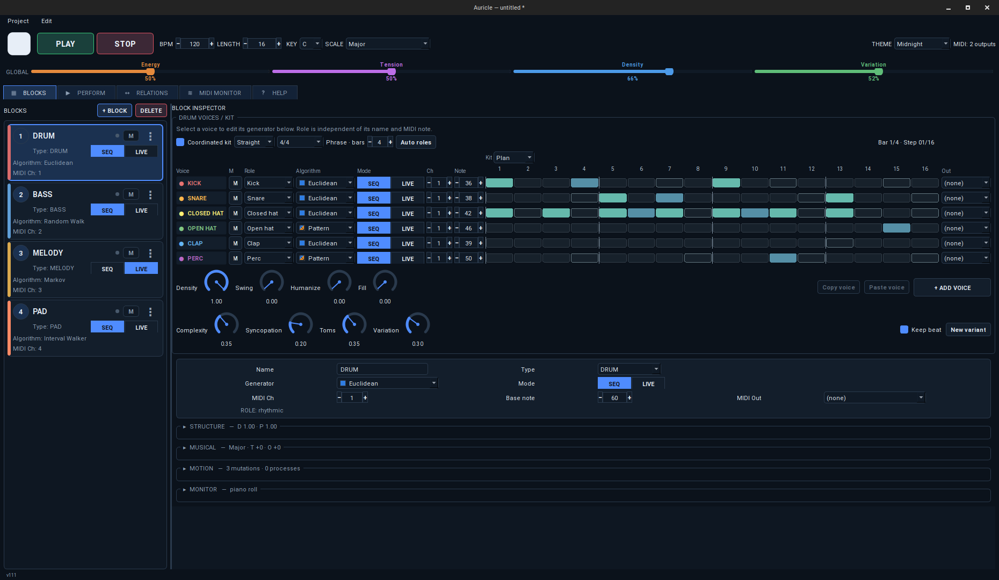

# Auricle v111

Полный комплект Auricle для публикации и сборки. Включает актуальные исходники, обновлённые assets, демонстрационные проекты и тесты; предыдущие patch-архивы не требуются.

## Музыка и взаимодействие

- **Диалог инструментов:** пары вопрос / ответ в Relations, длина реплик в тактах, размер, паузы, разделение и вероятность цикла. Own phrase сохраняет свою фразу, Echo и Contrast используют контур и акценты принятой реплики в регистре отвечающего блока. Таймлайн показывает текущий ход; механизм охватывает SEQ, LIVE, мотивы и Drum Voices.
- **Гармонический план:** редактируемые аккорды и их длительности, общий музыкальный контекст для CHORD / PAD, BASS и MELODY. Исправлен постепенный уход аккордов в высокие октавы: учитываются базовая нота и границы регистра блока.
- **Согласованный Drum Kit:** роли голосов, общая сетка, размеры 2/4, 3/4, 4/4, 5/4, 6/8, 7/8 и 12/8; Complexity, Syncopation, Toms, Variation и New variant. Density, Swing, Humanize и Fill применяются к голосам, включая смешанный SEQ / LIVE.
- **Паттерны и мотивы:** Plan / Output, вероятность отдельных шагов, копирование настроек звука между голосами; развитие мотивов с возвратом к теме и сохранением вариантов.

## Интерфейс и рабочий процесс

- Глобальные макросы в общей верхней панели, компактные карточки Perform, графики техник и таймлайн фразы с регулировкой длительности.
- Единое добавление процессов, мутаций и Relations редактируемыми строками; цветные Source / Destination.
- Undo / Redo, объединение непрерывных жестов, восстановление прерванных сессий и просмотр влияний на значения параметров.
- Закреплённая панель Drum Voices / Kit и индивидуальные настройки голоса, включая MIDI-канал и ноту.

## Подготовка публикации и сборки

- Сохранены все пять оригинальных PNG / ICO / ICNS из актуального `assets/`.
- Новый логотип отображается в собственных цветах при переключении темы.
- Исправлен состав Python-пакета: включены новые модули и ресурсы; ресурсы доступны вне каталога исходников.
- Общий PyInstaller spec собирает Windows / Linux и настоящий macOS `.app`; используются отдельные ICO / ICNS. Неиспользуемые Qt PDF / WebEngine исключены из сборки.
- Обновлены скрипты установки и упаковки, CI и release workflow. Проверяется совпадение версии и тега; добавлены проверка запуска и SHA-256 для файлов релиза.
- В README и это описание включён предоставленный скриншот.

## Файлы автоматического релиза

| Файл | Платформа |
| --- | --- |
| `Auricle-v111-windows-x64.zip` | Windows x64, распаковать весь каталог |
| `Auricle-v111-linux-x64.AppImage` | Linux x64, сделать исполняемым |
| `Auricle-v111-macos-arm64.dmg` | macOS Apple Silicon |
| `Auricle-v111-macos-x64.dmg` | macOS Intel |
| `SHA256SUMS.txt` | Контрольные суммы четырёх файлов |

Эти исполняемые файлы создаются workflow на GitHub; исходный ZIP сам по себе их не содержит. Подпись Windows и notarization macOS не настроены. Для воспроизведения нужны MIDI-приёмник и подходящий выходной порт.

[Запуск и описание проекта](README.md) · [Сборка](docs/BUILDING.md) · [История изменений](CHANGELOG.md)
